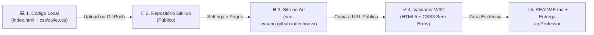

# 🌐 Guia Orientador do Aluno: Entrega via GitHub Pages & Validação Oficial W3C

**Unidade Curricular:** Linguagem de Marcação (HTML5 & CSS3)  
**Aplicação:** Avaliação Somativa – Portal Corporativo **TechNova Solutions**  
**Objetivo deste Guia:** Ensinar passo a passo como publicar seu projeto no **GitHub Pages**, como validar seu código **HTML5 e CSS3 diretamente pela URL pública do GitHub no W3C** (Critério 15 do Plano de Ensino) e como configurar a **validação automática no GitHub Actions**.

---

## 📌 Visão Geral do Fluxo de Entrega e Validação

Na indústria de desenvolvimento de software, não entregamos sites por arquivo `.zip` ou pendrive. Utilizamos o **GitHub** para guardar o código-fonte, o **GitHub Pages** para hospedar o site na internet e o **Validador Oficial da W3C** conectado diretamente ao link do GitHub Pages para auditar a qualidade técnica do código:



---

# Parte 1: Preparando sua Pasta Antes de Subir para o GitHub

Antes de enviar seus arquivos, revise estas **3 Regras Obrigatórias** (90% dos erros no GitHub Pages acontecem aqui!):

1. **O arquivo principal DEVE se chamar `index.html`** (tudo em letras minúsculas) e deve estar na **raiz** da pasta (fora de qualquer subpasta).
2. **Proibido espaços, acentos ou letras maiúsculas em nomes de arquivos e pastas:**
   - ❌ Errado: `Meu Estilo.CSS`, `Foto Equipe 1.WEBP`, `Img/Logo.SVG`
   - ✅ Correto: `css/style.css`, `img/equipe-1.webp`, `img/logo.svg`
   - *Por quê?* O servidor do GitHub Pages roda em Linux, que diferencia maiúsculas de minúsculas (*Case-Sensitive*).
3. **Use apenas caminhos relativos nos seus links e imagens:**
   - ❌ Errado: `` (Só funciona no seu PC!)
   - ❌ Errado: `<link rel="stylesheet" href="/css/style.css">` (A `/` inicial quebra no GitHub Pages!)
   - ✅ Correto: `` e `<link rel="stylesheet" href="css/style.css">`

### Estrutura Exata que você deve ter:
```
📦 technova-solutions/
 ┣ 📄 index.html          (Página principal na raiz)
 ┣ 📄 wireframe.png       (Foto/Exportação do seu wireframe)
 ┣ 📄 README.md           (Documentação do projeto + Links W3C)
 ┣ 📂 css/
 ┃ ┗ 🎨 style.css         (Folha de estilo externa)
 ┗ 📂 img/                (Imagens otimizadas em .webp)
```

---

# Parte 2: Como Subir o Projeto e Ativar o GitHub Pages

Você pode enviar seus arquivos pelo **Navegador (Opção A)** ou pelo **Terminal Git no VS Code (Opção B)**.

---

### 🟢 Opção A: Pelo Navegador Web (Mais Simples)

1. Acesse [github.com](https://github.com/) e faça login na sua conta.
2. No canto superior direito, clique no botão **`+`** ➔ **New repository**.
3. Preencha os dados do repositório:
   - **Repository name:** `technova-solutions`
   - **Visibilidade:** Marque **Public** *(Obrigatório para o GitHub Pages e para o W3C conseguir ler seu site!)*.
   - Marque a caixa **Add a README file**.
   - Clique no botão verde **Create repository**.
4. Na página do repositório criado, clique em **Add file** ➔ **Upload files**.
5. Abra a pasta do projeto no seu computador, selecione o arquivo `index.html`, o `wireframe.png`, a pasta `css/` e a pasta `img/` e **arraste tudo para dentro da caixa do navegador**.
   > ⚠️ **Atenção:** Arraste os itens de dentro da pasta (para que o `index.html` fique visível na tela inicial do repositório), e **não** a pasta geral por fora!
6. No final da página, escreva a mensagem do commit: `"Entrega Sprint - Portal TechNova Solutions"` e clique no botão verde **Commit changes**.

---

### 💻 Opção B: Pelo Terminal Git no VS Code (Comandos Profissionais)

Se preferir usar o terminal integrado do VS Code (`Ctrl + '` ou `Ctrl + J`), crie um repositório público vazio no GitHub (sem marcar o README) e execute:

```bash
# 1. Inicia o controle de versão Git na pasta do projeto
git init

# 2. Adiciona todos os arquivos (index.html, css/, img/, wireframe.png)
git add .

# 3. Registra o pacote de alterações (Commit)
git commit -m "feat: portal corporativo TechNova Solutions completo"

# 4. Renomeia a branch principal para main
git branch -M main

# 5. Conecta sua pasta local ao repositório do seu GitHub
git remote add origin https://github.com/SEU-USUARIO/technova-solutions.git

# 6. Envia os arquivos para o GitHub
git push -u origin main
```

---

### 🚀 Ativando a Hospedagem no GitHub Pages (Obrigatório para Ambos os Métodos)

1. Dentro do seu repositório no GitHub, clique na aba superior **Settings** (⚙️ Configurações).
2. No menu lateral esquerdo, desça até a seção *"Code and automation"* e clique em **Pages**.
3. Em **Build and deployment** ➔ **Branch**, clique no botão onde está escrito **None** e selecione **`main`**.
4. Deixe a pasta ao lado selecionada como **`/ (root)`** e clique no botão **Save**.
5. Aguarde cerca de **1 a 2 minutos** e recarregue a página (`F5`). Aparecerá um banner no topo com o endereço oficial do seu site publicado:
   > 🌐 **Your site is live at:** `https://SEU-USUARIO.github.io/technova-solutions/`

---

# Parte 3: Como Fazer a Validação W3C Direto pelo Link do GitHub Pages

Com o seu site publicado no GitHub Pages, você **não precisa** copiar e colar código ou subir arquivos manualmente no W3C. O próprio servidor da W3C vai acessar a URL do seu GitHub Pages e auditar seu projeto online!

---

## ✅ 3.1 Validando o HTML5 via URL do GitHub Pages (`Validate by URI`)

1. Copie o link público do seu site no GitHub Pages (ex: `https://seu-usuario.github.io/technova-solutions/`).
2. Abra o **Validador Oficial de HTML do W3C**:  
   👉 [https://validator.w3.org/](https://validator.w3.org/)
3. Certifique-se de estar na primeira aba chamada **Validate by URI** (Validar por Endereço/URL).
4. No campo **Address**, cole o link do seu GitHub Pages:  
   `https://seu-usuario.github.io/technova-solutions/`
5. Clique no botão **Check**.

### Como interpretar o resultado do W3C HTML Validator:
- 🟢 **Faixa Verde (`Document checking completed. No errors or warnings to show.`):**  
  **Parabéns!** Seu código HTML5 está 100% em conformidade com as normas internacionais da W3C! Tire um print dessa tela (mostrando a URL do seu GitHub Pages e a faixa verde) e guarde o link da página de resultado.
- 🟡 **Avisos (`Warning` / `Info`):**  
  Recomendações de melhoria (ex: `<section>` sem título `<h2>`-`<h6>`). Revise para deixar o código limpo.
- 🔴 **Erros (`Error`):**  
  Indicam falhas que **precisam ser corrigidas** para atingir o Critério 15 da Avaliação Somativa. O validador mostra exatamente a **Linha (`From line X`)** onde está o erro.

---

## 🎨 3.2 Validando o CSS3 via URL do GitHub Pages

1. Abra o **Validador Oficial de CSS do W3C (Jigsaw)**:  
   👉 [https://jigsaw.w3.org/css-validator/](https://jigsaw.w3.org/css-validator/)
2. Na aba **Por URI** (By URI), cole o **mesmo link do seu GitHub Pages**:  
   `https://seu-usuario.github.io/technova-solutions/`  
   *(O validador da W3C lerá seu `index.html`, encontrará automaticamente o `<link rel="stylesheet" href="css/style.css">` e validará todo o seu CSS!).*
3. Clique em **Verificar** (Check).
4. **Resultado Esperado:**  
   🟢 Faixa Verde: **"Parabéns! Não foram encontrados erros! Este documento foi validado como CSS nível 3 + SVG!"**

---

## 🛠️ Tabela de Consulta Rápida: Como Corrigir os Erros Mais Comuns do W3C

Se o validador W3C apontar algum erro vermelho ao ler seu GitHub Pages, consulte esta tabela para corrigir no seu VS Code e atualizar o GitHub:

| Mensagem de Erro no W3C Validator | O que significa em Português? | Como Corrigir no Seu Código? |
| :--- | :--- | :--- |
| `An img element must have an alt attribute` | Uma tag `` foi inserida sem o atributo obrigatório `alt`. | Adicione `alt="Descrição da imagem"` em todas as tags ``. |
| `Element div not allowed as child of element ul` | Você colocou uma `<div>` ou `<p>` diretamente dentro de uma lista `<ul>`. | Dentro de `<ul>` ou `<ol>`, os únicos filhos diretos permitidos são tags `<li>`. |
| `Duplicate ID ...` | Você usou o mesmo `id="... "` em dois elementos diferentes. | Um `id` deve ser único na página inteira. Troque por `class="..."` ou mude o nome do `id`. |
| `The for attribute of the label element must refer to a non-hidden form control` | O `<label for="x">` aponta para um `id="x"` que não existe no `<input>`. | Certifique-se de que o texto do `for=""` na `<label>` seja exatamente igual ao `id=""` do `<input>`. |
| `Bad value ... for attribute src on element img: Illegal character in path: space is not allowed` | O nome da imagem no atributo `src=""` possui espaço em branco (ex: `src="img/foto 1.webp"`). | Renomeie o arquivo tirando espaços (ex: `src="img/foto-1.webp"`). |
| `Section lacks heading. Consider using h2-h6 elements` | Você criou uma `<section>` ou `<article>` sem nenhum título `<h2>`-`<h6>` dentro. | Adicione um título semântico (`<h2>` ou `<h3>`) identificando o assunto da seção. |
| `Table column 2 established by element td has no cells beginning in it` | A soma de `colspan` ou `rowspan` da sua tabela não bate com o número de colunas do `<thead>`. | Conte quantas colunas existem no `<thead>` e ajuste os valores de `colspan`/`rowspan` nas linhas abaixo. |

---

# Parte 4: Documentando a Validação no `README.md` do seu GitHub (Padrão Profissional)

Para comprovar a validação W3C de forma automática e profissional no seu repositório do GitHub, edite o arquivo **`README.md`** do seu projeto e cole o modelo abaixo (substituindo `SEU-USUARIO` pelo seu nome de usuário do GitHub).

Os links especiais abaixo já abrem o validador da W3C testando a sua página ao vivo com 1 clique!

```markdown
# 🚀 Portal Corporativo TechNova Solutions

Projeto desenvolvido para a **Avaliação Somativa** da Unidade Curricular de **Linguagem de Marcação (HTML5 & CSS3)**.

---

## 🔗 Links Oficiais da Entrega
- 🌐 **Site Publicado (GitHub Pages):** [https://SEU-USUARIO.github.io/technova-solutions/](https://SEU-USUARIO.github.io/technova-solutions/)
- 📐 **Wireframe do Projeto:** [Visualizar Wireframe](./wireframe.png)

---

## ✅ Auditoria e Validação Oficial W3C (Clique para Verificar ao Vivo)

Clique nos botões abaixo para executar a validação em tempo real diretamente no servidor do consórcio W3C:

- 🔍 **[Validar HTML5 no W3C (Ao Vivo)](https://validator.w3.org/nu/?doc=https%3A%2F%2FSEU-USUARIO.github.io%2Ftechnova-solutions%2F)**
- 🎨 **[Validar CSS3 no W3C Jigsaw (Ao Vivo)](https://jigsaw.w3.org/css-validator/validator?uri=https%3A%2F%2FSEU-USUARIO.github.io%2Ftechnova-solutions%2F&profile=css3svg)**

---

## 🛠️ Tecnologias e Padrões Aplicados
- **HTML5 Semântico:** `<header>`, `<nav>`, `<main>`, `<section>`, `<article>`, `<aside>`, `<figure>`, `<footer>`.
- **Tabelas Avançadas:** `<thead>`, `<tbody>`, `<tfoot>`, `scope`, `colspan`, `rowspan` e efeito zebrado.
- **Formulários Validados:** `<fieldset>`, `<legend>`, `<label for>`, validações nativas `required`.
- **Otimização Gráfica:** Imagens em formato `.webp` e ícones vetoriais em **SVG Inline** estilizados via CSS.
- **CSS3 Moderno:** Variáveis CSS (`:root`), Box Model, Flexbox/Grid, Menu `position: sticky`, Transições e Animações.
```

---

# 🌟 Bônus (Critério Desejável de Autonomia): Validação Automática com GitHub Actions!

Quer impressionar na avaliação e fazer o próprio **GitHub validar seu código HTML5 automaticamente** toda vez que você enviar uma alteração (`git push` ou upload)?

1. No seu repositório do GitHub, clique na aba **Actions** (no topo).
2. Clique no link **set up a workflow yourself** (configurar um fluxo você mesmo).
3. O GitHub criará o arquivo `.github/workflows/main.yml`. Renomeie para `w3c-validator.yml` e cole o código abaixo:

```yaml
name: Auditoria Oficial W3C HTML5

on:
  push:
    branches: [ main ]

jobs:
  w3c-validation:
    runs-on: ubuntu-latest
    steps:
      - name: Baixar código do repositório
        uses: actions/checkout@v4

      - name: Validar HTML5 no W3C Validator
        uses: Cyb3r-Jak3/html5validator-action@v7
        with:
          root: .
          css: true
```

4. Clique no botão verde **Commit changes**.
5. Agora, a cada atualização que você fizer no repositório, a aba **Actions** do GitHub executará o validador W3C em todos os seus arquivos `.html` e `.css` e mostrará um selo verde **✔️ Passing** se não houver nenhum erro!

